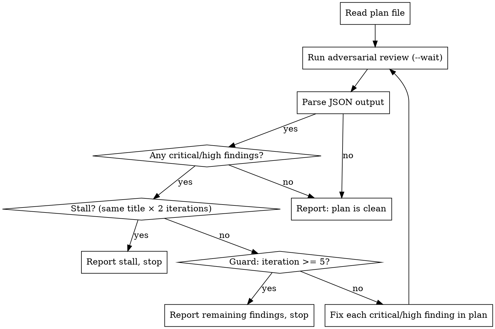

# Plan Adversarial Review Loop

Run `/codex:adversarial-review` on a plan file, fix all `critical` and `high` findings,
re-review, and repeat until the plan is clean or a stall is detected.

## Authority Override

**This skill explicitly overrides `codex-result-handling`'s "STOP after review" rule.**
That rule governs interactive review commands. This skill is an autonomous fix loop — the
user has given standing authorization to implement fixes without asking after each iteration.
Do not stop to ask permission between loop iterations.

## Termination Conditions (exit when ANY is true)

1. **Clean pass**: verdict is `approve` AND no `critical`, `high`, or `medium` findings.
2. **Blockers resolved**: verdict is `needs-attention` but ALL findings are `low`.
3. **Stall**: a `critical`, `high`, or `medium` finding with the same `title` appears in two
   consecutive iterations — surface it to the user and stop. Do not loop forever on unfixable findings.
4. **Guard**: 5 iterations reached — report remaining findings and stop.

## Loop



## Step-by-Step

**Before the loop**

1. Identify the plan file from the user's argument (e.g., `docs/superpowers/plans/2026-06-19-foo.md`).
2. Read the file into context.
3. Ensure the file is visible in the working tree diff. If it is committed and unchanged,
   make a whitespace-only touch so it appears in `git diff --name-only HEAD` (or ask the user
   to stage it). The companion script reviews working-tree scope by default.
4. Initialize: `iteration = 0`, `previous_titles = []`.

**Each iteration**

1. Increment `iteration`.
2. Run the review via Bash (NOT the Skill tool — `adversarial-review` has `disable-model-invocation: true`
   and cannot be invoked through the Skill tool):
   ```bash
   node "/Users/ace/.claude/plugins/cache/openai-codex/codex/1.0.4/scripts/codex-companion.mjs" \
     adversarial-review "--wait focus: <plan-file-path>"
   ```
   Replace `<plan-file-path>` with the actual relative path to the plan file.
3. Receive the JSON output from stdout. Parse `verdict`, `findings`, `summary`.
4. Extract blockers: findings where `severity == "critical" OR "high" OR "medium"`.
5. Check termination (in order):
   - No blockers → **clean, exit**.
   - Stall check: for each blocker, if its `title` is in `previous_titles` → **stall, exit**.
   - `iteration >= 5` → **guard, exit**.
6. Update `previous_titles` with this iteration's blocker titles.
7. For each blocker (ordered by severity desc, then confidence desc):
   - Read the plan section at `line_start`–`line_end`.
   - Apply the `recommendation` as a targeted edit. Do not rewrite adjacent sections.
   - Do not touch `low` findings.
8. Show a brief iteration summary: `Iteration N: fixed M blocker(s) — [titles]. Re-reviewing…`
9. Go to step 1.

**Exit reporting**

- **Clean**: "Plan passed adversarial review after N iteration(s). No critical or high findings."
- **Stall**: "Stall detected on: [title]. This finding reappeared unchanged — needs manual
  judgment. Remaining blockers: [list]."
- **Guard**: "Reached 5-iteration limit. Remaining critical/high findings: [list with recommendations]."

## What NOT to Fix

- `low` findings during the loop — scope is `critical`, `high`, and `medium` only.
- Code outside the plan file — this skill operates on the plan document, not the implementation.
- Style, naming, or formatting notes — the adversarial review filters these already.

## Common Mistakes

| Mistake | Fix |
|---|---|
| Stopping after first review to ask permission | This skill grants standing authorization — continue the loop |
| Fixing low findings during the loop | Only fix critical/high/medium; leave low for the user |
| Rewriting whole sections "to be safe" | Make the minimum targeted change per `recommendation` |
| Looping past a stall | Two identical titles = unfixable by document edit; surface it |
| Forgetting the working-tree visibility step | The companion won't see committed-and-unchanged files |
